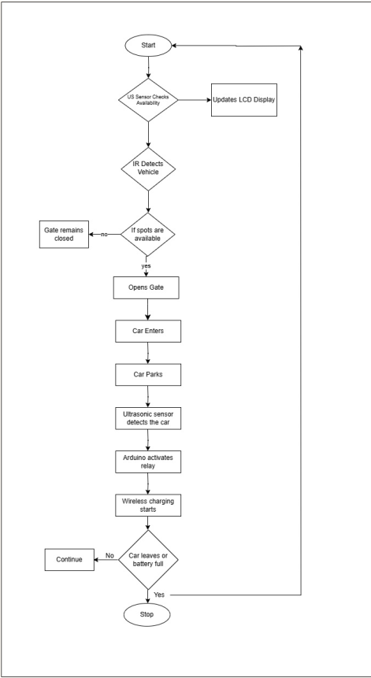
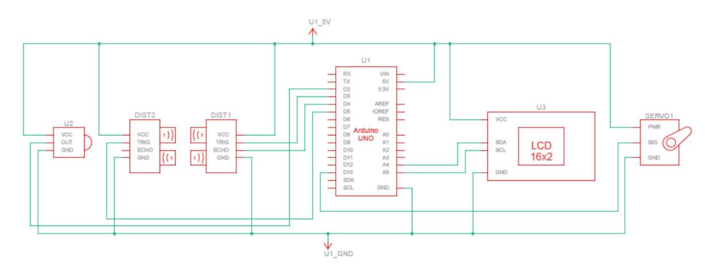
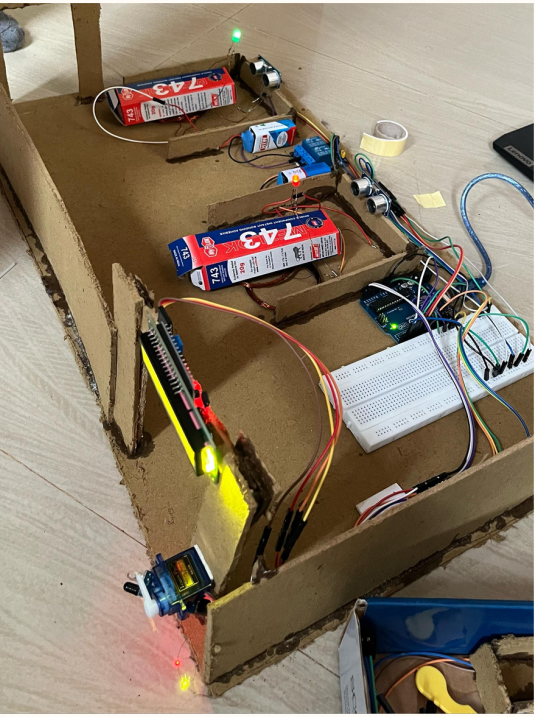

# Wireless Charging Parking Lot and Parking Management

A small-scale smart parking prototype built with an Arduino Uno. It detects vehicles at the entrance, opens a gate only when a slot is free, shows slot status on an LCD, and switches on a wireless charging coil when a car is parked.

B.Tech mini project, Department of Electronics and Communication Engineering, College of Engineering Thalassery (APJ Abdul Kalam Technological University), 2025.

## How it works

1. An IR sensor at the entrance detects an approaching vehicle.
2. Ultrasonic sensors (HC-SR04) monitor the parking slots. If a slot is free, the Arduino turns the servo to open the gate. If all slots are full, the gate stays closed.
3. A 16x2 I2C LCD shows the current parking availability.
4. When a car parks, the ultrasonic sensor for that slot detects it and the Arduino switches the relay on. This powers the wireless transmitter coil, and the receiver coil on the car side picks up power by inductive coupling.
5. When the car leaves, the relay switches off and charging stops.



## Hardware

- Arduino Uno R3
- IR obstacle sensor (gate)
- HC-SR04 ultrasonic sensors (slot detection)
- SG90 servo motor (gate)
- 16x2 LCD with I2C backpack
- 2-channel relay module
- Wireless power transmitter and receiver coil set
- 9V batteries, 5V supply, breadboard, jumper wires

## Circuit




## Prototype

Cardboard scale model of the parking lot with the gate, slot sensors, LCD and charging pads mounted on it.



## Repository structure

```text
├── src/
│   └── smart_parking.ino      # Arduino firmware
├── docs/
│   ├── final_report.docx      # Project report
│   ├── system_flowchart.png
│   ├── circuit_schematic.png
│   ├── circuit_wiring.png
│   └── hardware_prototype.png
└── README.md
```

## Running the code

1. Open `src/smart_parking.ino` in the Arduino IDE.
2. Install the `LiquidCrystal_I2C` and `Servo` libraries from the Library Manager.
3. Select **Arduino Uno** and the correct port, then upload.

## Limitations and future work

- This is a small prototype. The wireless charging uses a low-power coil module, not a real EV charger.
- Charging is switched on by slot occupancy only. It does not measure battery level or charging current.
- Possible improvements: automatic billing based on parking time or energy used, a mobile app to check slot status remotely, solar power for the system, and a more efficient charging coil design.

## Team

- Anandhu V K (TLY22EC029)
- Abhishek K (TLY22EC007)
- Anudev S S (TLY22EC031)
- Ajal Raj P P (TLY22EC020)

Guide: Ms. Anagha A, Assistant Professor, Department of ECE.

## References

1. X. Lu et al., "Wireless Charging Technologies: Fundamentals, Standards, and Network Applications," IEEE Communications Surveys & Tutorials, 18(2), 2016.
2. M. V. Sudhakar et al., "Development of smart parking management system," Materials Today: Proceedings, 80, 2023.
3. S. S. Channamallu et al., "A review of smart parking systems," Transportation Research Procedia, 73, 2023.
4. M. Fareq et al., "Low wireless power transfer using inductive coupling for mobile phone charger," J. Phys.: Conf. Ser., 495(1), 2014.
